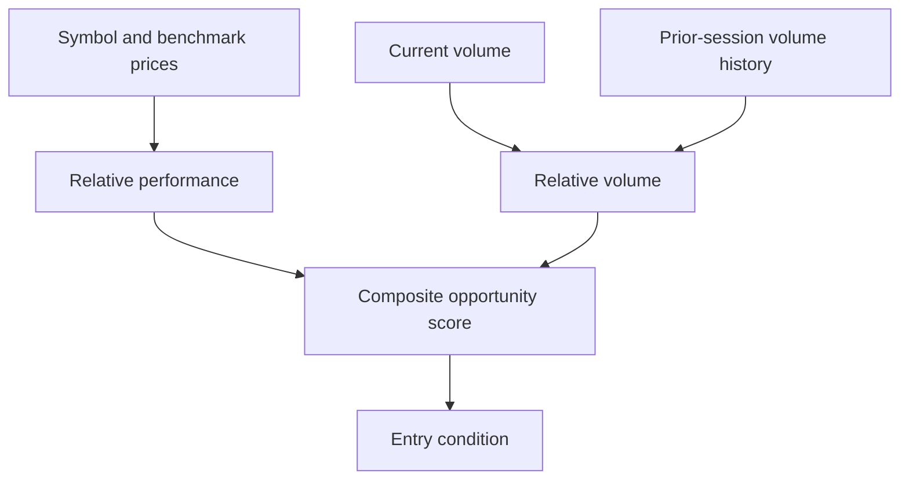

# Indicator Framework: architecture and development proposal

**Date:** November 28, 2026  
**Status:** Design proposal for discussion; no indicator engine, storage migration,
new provider subscription, backtest engine, or trading activation is implemented
by this document.

This proposal records the user's requirements and subsequent clarification about
short-term studies using MasterBot observations. Recommendations below remain
recommendations until accepted through the development discussion. No first
indicator formula has been selected.

## 1. Direction and scope

The framework should support current prices, volumes and session statistics;
historical sequences and reference features; multiple instruments; parameters;
and the outputs of other indicators. Some calculations will be incremental and
stateful. Live calculation, historical evaluation and optimization should reuse
the same mathematical definitions and time/data semantics.

Provider-sourced history from Schwab and potentially Massive is the primary path
for broader research and optimization. Locally cached provider historical data
is still provider history. Our collected observations remain useful for live
operation, diagnostics, and potentially narrow short-term studies.

The user clarified that this is not an absolute ban on local-data backtesting.
The constraint is evidentiary: tier membership determines which observations
exist. A study cannot assume Hot-frequency observations for a symbol that was
only sampled in Uni. Full simulation of alternative membership and collection
policies is deferred until a concrete question and adequate data coverage
justify it. It is not an initial framework requirement.

These requirements do not require an enterprise platform. The first version can
be a small Python calculation library, an input adapter, and an Overlay panel.
The important early choices are ownership, interfaces, identity and time meaning.

## 2. Responsibilities

| Part | Responsibility | Does not own |
| --- | --- | --- |
| Data adapters and data service | Acquire or read inputs, normalize documented fields, track source/coverage, supply current values and historical windows | Indicator formulas or trading decisions |
| Indicator definitions and registry | Describe calculations, parameters, required data, dependencies, outputs and update rules | Provider authentication or dashboard callbacks |
| Calculation runtime | Own configured instances, dependency ordering, active windows, incremental state and results | Broker submission or UI appearance |
| Overlay | Configure and inspect calculations; display results, readiness and explanations | The continuing life of an active calculation or strategy |
| Strategy | Interpret indicator results in position/order context; determine intended actions | Low-level data fetching or broker transport |
| Execution and supervision | Review, submit and reconcile approved order intentions | Recomputing formulas inside order handlers |

The indicator core receives explicit input data and evaluation context. It does
not fetch from Schwab or Massive, inspect a Dash control, open arbitrary files,
or consult the system clock. Different drivers supply live or historical inputs
to the same calculation logic.

These are logical boundaries, not a requirement for six services or processes.
Use local components and ordinary function calls first. A future supervised
strategy must have a lifetime independent of browser refreshes and chart changes.

## 3. Definitions, configured instances and results

An indicator definition is a reusable algorithm. An instance supplies its actual
instruments, parameters, input sources and dependency bindings.

For example, a rolling-mean definition can produce a 20-bar MSFT instance and a
50-bar MSFT instance. They can share read-only source history, but not the mutable
state belonging to different calculations.

Each registered definition should declare:

| Contract item | Meaning |
| --- | --- |
| Name and version | Stable algorithm identity and code revision |
| Parameters | Types, defaults, ranges, units and whether a parameter may be optimized |
| Inputs | Required fields, instrument roles, timeframes and source capabilities |
| History | Required lookback and initialization/warm-up policy |
| Dependencies | Other configured indicator outputs consumed |
| Outputs | Named numeric, Boolean, categorical or vector values, with units |
| Update rule | New quote, completed bar, session boundary, scheduled time, or dependency update |
| Data rules | Session convention, provisional-bar policy, missing/stale handling and time alignment |
| State rules | Initialization, update, reset, revision response and checkpoint compatibility |

An output needs more than a number. Retain its instrument scope, effective time,
evaluation/input cutoff, definition/configuration identity, input data versions,
and readiness/quality information. A display can show 1.8 while also identifying
the data as stale. An unavailable Boolean is unknown, not automatically false.

Prefer distinct status and value fields. Warm-up, missing input, stale dependency,
unsupported data, provisional result and calculation error should remain
distinguishable. Downstream consumers should receive these facts as data rather
than infer them from an empty chart or a zero.

## 4. Indicators depending on indicators

An illustrative dependency graph, not a selected strategy:

The runtime resolves dependencies before their consumers and computes a shared
configured dependency once per relevant update. If several displays or strategies
use the same relative-volume instance, they read the same result.

At one evaluation instant, the graph must have no circular dependency. Explicit
recurrences such as using a previous indicator value are different: they can be
implemented as declared prior state with an initial condition and a time delay.
Do not attempt to solve instantaneous circular references implicitly.

Publish coherent result generations. A downstream calculation must know whether
its inputs represent the same completed bar or a declared combination of latest
known values. Updating one dependency must not silently combine it with an
incompatible old result from another dependency.

Refresh only affected calculations. A prior-session volume median may change
once per session; a completed-bar indicator may change every five minutes; a
current-price feature may update with quotes. Browser redraw frequency is not
the calculation schedule.

## 5. Data contracts and multiple symbols

The shared data service should describe what a requested dataset actually means:

- Instrument identity and historical ticker mapping, not only today's ticker.
- Provider, endpoint/dataset and source content version.
- Event time or interval start/end, with explicit timezone and timestamp units.
- Price meaning: last trade, bid, ask, midpoint, bar close or another named field.
- Volume meaning: cumulative session volume or volume within one interval.
- Regular/extended session policy and the relevant market calendar.
- Raw, split-adjusted or other explicit adjustment convention.
- Completeness, gaps, provisional status and revision identity.
- Live receipt metadata or the research availability model.
- Permitted study profile, coverage and provenance of derived inputs.

Normalize representations without erasing semantic differences. Provider adapters
translate fields into this contract; they do not imply that two providers must
produce identical prices, volumes, bars or histories. Dataset changes and provider
fallbacks must be explicit, versioned choices.

For an indicator comparing MSFT and a benchmark, use either matching completed
intervals or an explicit as-of rule: the newest value available by the evaluation
time, subject to an age limit. The latter is asynchronous, even if both values
are displayed in the same row. Never select a later observation to fill an
earlier historical request.

Declare which fields may carry forward, for how long, and with what status.
Price can sometimes remain a useful last-known value; a missing bar's volume
cannot be invented by copying another interval. A missing record is not proof
of zero activity, nor automatically a transport failure.

For daily inputs, distinguish the current session's evolving range and volume
from the previous completed session's values. A median of prior daily volumes
excludes the current unfinished day. A 10:00 calculation cannot use that day's
final high, low, close or volume.

Declare whether a lookback means a count of observed bars, elapsed trading
time, or completed sessions. Missing intervals and halts can make these windows
different. Likewise, today's volume divided by median full-day volume measures
a different quantity from volume relative to the usual cumulative volume at
the same time of day; the latter requires appropriate intraday history.

### Current acquisition limitation

The existing owned OHLCV worker follows one selected chart symbol. A calculation
requiring multiple symbols will eventually need a data-demand manager that
combines the requirements of active indicators and strategies independently of
the visible chart. It can deduplicate symbol/interval requests, preload history,
and respect provider/application budgets.

Changing the chart must not stop inputs required by an active strategy. This
manager can be deferred for the first single-symbol prototype while instrument
roles and required-symbol lists are present in the interface. Unsupported demands
must be reported rather than assumed satisfied.

The existing five-attempts-per-rolling-minute OHLCV policy does not guarantee
freshness for an arbitrary number of symbols. It is not a Schwab transport quota.

## 6. Time, availability and revisions

Keep these meanings separate:

| Time | Question answered |
| --- | --- |
| Market event or bar interval | Which market instant/period does this value describe? |
| Live receipt/processing time | When did MasterBot obtain and accept this version? |
| Research availability time/policy | When may a simulated calculation use this value? |

A historical file downloaded today can describe years of prior bars. Today's
download time is provenance; it is not the simulated availability time for every
bar. Conversely, treating a bar as available exactly at its closing boundary
is a modeling assumption unless historical publication evidence supports it.

The first research runner can use an explicit completed-bar availability rule.
It must label that rule and any assumed delay. More detailed history may later
support a richer model. This permits progress without claiming to reproduce
every live delay.

Existing Overlay candles expose an availability property equal to bar end;
the containing cache separately records acquisition time. Reusing the candle
objects alone must not turn the display's completion convention into a claim
about historical provider publication. Live cache acceptance already checks
receipt metadata; preserve that distinction in the new adapter.

Completed bars may still be corrected later. Massive documents replacement
aggregate updates and differences between live-delivered and subsequent REST
history [S1]. Treat a repeated interval as a revised value, not additional
volume. Retain the dataset version used by a research run, and rebuild affected
indicator descendants when applying a correction.

An unfinished bar is also a replacement of its prior provisional version. The
first prototype can consume completed bars only. That keeps implementation small
without designing an append-only contract that cannot later express corrections.

Current Overlay live updates require the old completed sequence to remain an
exact prefix. That is the current display acceptance rule, not proof that
providers cannot revise history. A general revision policy is later work, with
an explicit unsupported/correction status until implemented.

## 7. Efficient history and incremental calculation

Separate four things:

1. Source history.
2. A calculation's working state.
3. Its latest output.
4. Its optional historical output series.

For active calculations, keep bounded typed arrays or ring buffers in RAM.
Retain the largest active lookback needed for a shared input, and let calculations
read appropriate windows. Avoid copying an entire multi-year table on each
quote or giving every indicator its own redundant copy of the same bars.

Use compact incremental state where the formula allows it:

| Calculation | Useful working state |
| --- | --- |
| Rolling mean | Running sum, count and outgoing/incoming values |
| Exponential average | Prior average plus declared initialization state |
| Session range | Current high/low plus explicit session reset |
| Rolling median | The relevant window and an updateable ordered structure |
| Composite score | Latest eligible dependency results and their identities |

The rolling mean can subtract the oldest value and add the new one. A median
generally cannot be updated correctly from only its previous median. Stateful
algorithms still need whatever evidence their mathematics requires.

An update conceptually returns new state, output and quality metadata. Compare
incremental results with an independently computed reference over the same
inputs; periodically rebuild statistics where necessary to control numerical
drift. Define numerical tolerances rather than requiring meaningless bitwise
identity between all future execution backends.

Assign stable identities to inputs. Re-reading one completed bar must not add
it twice; an unchanged last price in a different legitimate observation is not
automatically a duplicate. Cumulative volume must not be summed at every poll.
Late corrections need a replacement/rebuild path, and session changes need
explicit reset behavior.

### Checkpoints and restart

Persist restart checkpoints at useful boundaries rather than serializing every
array on every screen refresh. A checkpoint should identify the definition,
parameters, instruments, source revisions, state format and last processed input.
Keep outputs and processing positions consistent so restart does not duplicate
effects.

If a checkpoint is absent or incompatible, warm the calculation from validated
history. If the necessary history is unavailable, report the limitation. Do not
silently restore a 20-bar state into a newly configured 50-bar instance.

## 8. Local historical store and reusable calculations

Yes: maintain a local store for history actually requested and reusable features.
Both live warm-up and offline research should use the same data access interface.
This avoids repeatedly downloading the same historical range or recomputing
common reference features.

Recommended storage roles:

| Data | Initial approach | Direction as usage grows |
| --- | --- | --- |
| Original provider responses and immutable normalized history | Reuse validated snapshots and source manifests | Compressed columnar files partitioned by useful time/source ranges |
| Active input windows and intermediate state | In-memory arrays and compact state objects | Same model with bounded retention |
| Dataset catalog, configuration versions, run manifests and checkpoints | Small local transactional store such as SQLite | Keep one clear write owner |
| Large historical calculations and feature series | Read bounded ranges through a storage interface | Parquet plus an analytical reader such as DuckDB |
| Optimization trials | Trial parameters, outcomes, summaries and selected artifacts | Retention based on reproducibility and demonstrated reuse |

This is a storage direction, not a requirement to introduce several databases
for the first example. The first implementation can reuse existing candle files
behind the access interface. Add larger storage machinery when a real dataset
or workload requires it.

Parquet is a compressed columnar format, and DuckDB can read selected columns
and filter ranges from it [S2]. SQLite WAL permits readers alongside a writer
but still serializes writes [S3]. These properties support a modest local design
with immutable research inputs, a small metadata writer and separate optimizer
working files. Keep heavy research off the live collection path.

Share causal, parameter-independent features across runs where their identity
matches. Do not persist every intermediate result from every parameter trial.
Cheap calculations can be recomputed; expensive common history features can be
cached; final run summaries and the artifacts needed to reproduce selected
results deserve durable storage.

Cache identity must include code/definition version, parameters, instrument
scope, timeframe/session and adjustment rules, source data revisions, dependency
identities, initialization and availability rules. For fitted features it also
includes the training period/model. A name such as "relative volume" is not a
sufficient cache key.

Keep the local observation journal logically distinct from provider-history
datasets. A study selects its source profile deliberately; it must not fall back
silently from provider history to our sparse polling observations. Derived
features inherit the source and coverage constraints of their inputs.

## 9. Common live and offline code

Use one indicator core with different drivers:

| Driver | Supplies | Uses |
| --- | --- | --- |
| Live | Committed current inputs, cached history, explicit live evaluation time | Active indicators and later strategies |
| Provider-history research | Versioned provider datasets and a simulated clock | Broad backtesting and optimization |
| Recorded-observation study | The actual saved observation stream in availability order | Operational replay and explicitly bounded short-term studies |

The live driver advances with accepted input events. The historical driver
advances through eligible historical events as quickly as useful. Both invoke
the same dependency and state transitions.

Initially, use one canonical update implementation. Later, optimized batch
implementations may accelerate research if they are checked against the same
semantics: initialization, order, gaps, revisions, alignment and output timing.
A common function signature alone is insufficient if the calculations differ.

Identical inputs and configuration should yield equivalent results. Different
providers, resolutions, publication delays or corrected datasets can legitimately
produce different results even when the code is identical.

The engine can be reused by local-journal diagnostics without making that journal
the default research dataset. This separates code reuse from a claim of
interchangeable evidence.

## 10. Backtesting scope and the membership/sampling problem

The user's clarification is central to scope:

| Activity | What we can study | Limitation |
| --- | --- | --- |
| Operational replay | What was recorded and what a calculation produces from it | No reconstruction of unobserved market intervals |
| Fixed-observation short-term study | Alternative indicators or decision rules on that same recorded stream | Conclusions are conditional on recorded collection/selection and coverage |
| Provider-history study | A declared strategy on an independently supplied historical dataset | Limited by that dataset's fields, resolution, revisions and execution model |
| Different membership or polling policy | A scenario whose required inputs are actually covered by recorded or independent data | Not supported where an alternative policy needs observations that do not exist |

For example, suppose the journal contains a symbol's Uni observations every
30 seconds. A hypothetical earlier promotion into Hot could have generated
two-second observations. The current journal cannot supply those missing
responses. Interpolation or forward-filling does not establish what Schwab would
have returned.

A fixed-observation study may change a calculation or decision rule while
holding the recorded data stream fixed. It may explicitly use less of that
evidence. If a rule requires new observations, it must report the unsupported
input rather than silently use a later price or assume a denser stream.

Our collection is selected by membership decisions, including reactions to
events such as halts. Findings on that selected stream do not establish how a
new policy would perform across all eligible instruments or opportunities.
Record the covered symbols/times, missing-data rules and the fixed-sampling
assumption. Trade outcome estimates additionally require a stated execution
model; an observed last trade is not proof of an obtainable fill.

Richer independent trade/quote history might support alternate sampling models
later. Massive documents historical quote files separately from bars, with
access depending on the dataset/plan [S4]. We have not established that available
account access or those datasets would satisfy a particular proposed study.
Even adequate market history would not recreate Schwab's exact API snapshots,
batching, retries or network delays.

Accordingly, do not implement a general counterfactual membership simulator
before the first indicator. If a future question needs one, first specify the
required inputs and check actual data sufficiency.

## 11. Provider differences and historical fidelity

A provider adapter should advertise capabilities and coverage, not promise
universal history. Existing Schwab acquisition supports our first adapter, but
precise historical depth and additional fields still need verification for each
new use. Massive remains a possible future integration.

Massive's REST aggregate documentation says that bars use eligible trades, gaps
can occur when no eligible trades exist, and the adjustment option defaults to
split-adjusted results [S5]. Its stock flat files are unadjusted [S6].
Consequently, preserve adjustment and gap semantics when combining datasets.

Resolve stable instrument identity, dated symbols, corporate actions, session
calendars and point-in-time universe definitions when a study depends on them.
Today's surviving symbols or current Hot roster must not silently stand in for
a historical candidate universe.

Historical five-minute OHLCV cannot determine an exact path within the bar,
the bid/ask spread at every instant, or the order in which both a stop and target
were crossed. Select a suitably coarse strategy, declare an approximation,
or require finer data. A future connector is not a reason to invent unavailable
fields today.

## 12. Offline optimization and function changes

Parameter optimization runs registered definitions with many valid parameter
sets. Formula tuning changes the definition version. Both need reproducible
experiments rather than hidden changes to an active instance.

For each research run, preserve:

- Source profile, dataset versions, coverage, normalization and availability rules.
- Indicator/dependency/strategy versions and initialization policy.
- Parameter search space, constraints, trial outcomes and random seed if used.
- Training/development, validation and final evaluation periods.
- Objective and execution assumptions, including relevant costs and fills.
- The exact configuration selected for a later operational trial.

Use chronological evaluation appropriate to the data. Fit learned scalers,
thresholds or models only on the training portion. Scikit-learn documents how
using future/test data for fitting or feature selection produces leakage [S7].
A deterministic rolling feature can be shared only when it uses the same
eligible preceding inputs; a model fitted on all history cannot be reused
across folds as though it had been fitted separately.

Repeatedly inspecting the final evaluation period while changing formulas turns
that period into development data. Keep a final untouched interval where
practical, record all relevant trials, and prefer results stable across periods
and nearby parameter choices to a single exceptional result.

If outcomes or labels overlap split boundaries, account for that overlap when
defining the split/gap. Do not blindly use random row splits for a time-dependent
strategy. Warm-up history preceding evaluation is distinct from fitting on
evaluation outcomes.

A strategy using a completed bar's closing value cannot automatically claim a
fill at that same close. Define the next eligible execution opportunity,
spread/slippage, order type and ambiguous intrabar handling when actual trade
backtesting is introduced.

The initial framework needs metadata and reproducibility hooks, not a full
optimizer or brokerage simulator.

## 13. Indicators, Strategy and Trading in the Overlay

| Workspace | User responsibilities and controls |
| --- | --- |
| Indicators | Select registered definitions; bind instruments/inputs/dependencies; adjust calculation parameters; inspect values, history, readiness and source explanations; choose display settings |
| Strategy | Combine indicator results into entry/exit conditions; choose crossing versus persistent conditions; set sizing, cooldowns and operating constraints; inspect simulated decisions and pinned configurations |
| Trading | Inspect active strategy, positions, proposed orders, approvals, order status, fills and reconciliation |

Strategy and Trading may begin as sections of one future tab. There is no need
to add empty tabs before these capabilities exist.

A numeric indicator measures a condition. A Boolean indicator may legitimately
say that entry conditions are satisfied. A strategy adds behavior over time:
whether already in a position, whether an order is pending, whether this is a new
crossing, and whether another action is allowed. A true value on ten successive
polls is not automatically ten purchase instructions.

Keep indicators free of order submission. Strategy produces an order intention;
execution/supervision handles its lifecycle. This makes the same decision logic
usable in simulation and eventual attended trading.

Give each parameter one authoritative home. The lookback for relative volume
belongs to its indicator. An entry threshold on the resulting numeric score
normally belongs to Strategy. If the indicator itself defines a Boolean threshold
test, that threshold belongs to that indicator definition and is referenced
elsewhere, not duplicated as an independent setting.

Changing appearance needs no recomputation. Changing a formula parameter creates
a new configured calculation and may require warm-up. A future active strategy
stays pinned to its selected versions until a replacement is deliberately
activated; browsing or experimenting on the Indicators tab should not mutate it.

## 14. Authoring and configuration

Recommended initial authoring model:

- Define and revise algorithms in version-controlled Python during development.
- Register their parameter/input/output contracts.
- Use Overlay controls to select them and edit validated settings.

This is compatible with custom indicators: custom means we can develop the
algorithm, not that the live UI must execute arbitrary Python entered into a
text box. New code can be developed and tested in the experimental checkout,
then made available as a registered definition.

A constrained expression/rule builder is a later possibility. It would use a
known set of operations and explicit dependencies, with the same versioning and
data rules. Do not make an unrestricted code editor or expression evaluator
part of the first operational interface.

## 15. First implementation and later extensions

The first prototype should establish:

1. A small registered definition contract with instrument roles, parameters,
   history requirements, output units and update rules.
2. A normalized completed-bar input adapter using a retained provider-history
   dataset and explicit availability assumptions.
3. A deterministic runtime with bounded state and dependency ordering.
4. One simple chosen indicator, plus a small dependent calculation in verification
   so other-indicator inputs are exercised.
5. An Indicators panel for configuration and visible output in the existing
   chart/inspector.
6. Checks that incremental/reference calculation, restart, warm-up, parameter
   isolation and historical cutoffs behave consistently.

The first formula remains a product choice to make after reviewing the framework.
The prototype should use a small genuine provider dataset plus narrowly scoped
synthetic fixtures for otherwise difficult boundary cases. Tests are not a claim
that local polling journals have become unrestricted backtest data.

Later, add capabilities when required by actual indicators:

- Multi-symbol demand management and richer time alignment.
- More historical datasets and provider adapters.
- A fuller late/corrected/provisional-data policy.
- Larger history storage and measured batch acceleration.
- Parameter searches and strategy evaluation with execution assumptions.
- Strategy configuration and supervised execution.
- Counterfactual membership/collection studies only if suitable data supports them.

Detailed transport/retry metrics remain deferred as previously agreed. This
architecture work does not reopen the completed live OHLCV demonstration or
MasterBot timing correction as prerequisites.

## 16. Source review and references

Repository source was inspected at the published experimental checkpoint
`99dbbca53d9cd117ff66eef74752d13c4b7185b5` and its equivalent local source tree.

- [Current Indicators placeholder](../../src/mb_market_data/quote_dashboard.py).
- [Selected-symbol owned OHLCV worker](../../src/mb_market_data/overlay_ohlcv_worker.py).
- [OHLCV scheduling and application request policy](../../src/mb_market_data/overlay_ohlcv_schedule.py).
- [Immutable live acquisition, publication and reader](../../src/mb_market_data/overlay_live_ohlcv.py).
- [Candle/cache model and completed-sequence acceptance](../../src/mb_market_data/observation_overlay.py).
- [Existing release plan and accepted delivery direction](../runbooks/Overlay_Unified_Release_Plan_2026-11-24.md).
- [MasterBot timing findings](../runbooks/Halt_Timing_Investigation_2026-11-27.md).

External facts below are grounded in primary documentation reviewed November 28.
Their existence does not establish account entitlement or project integration.

- **S1:** [Massive: late and revised aggregate bars](https://massive.com/knowledge-base/article/why-am-i-receiving-a-late-aggregate-bar-through-massives-websockets).
- **S2:** [DuckDB: reading and writing Parquet](https://duckdb.org/docs/stable/data/parquet/overview).
- **S3:** [SQLite: write-ahead logging and concurrency](https://www.sqlite.org/wal.html).
- **S4:** [Massive: historical stock quote files](https://massive.com/docs/flat-files/stocks/quotes).
- **S5:** [Massive: custom aggregate bars](https://massive.com/docs/rest/stocks/aggregates/custom-bars).
- **S6:** [Massive: stock flat-file overview](https://massive.com/docs/flat-files/stocks/overview).
- **S7:** [Scikit-learn: common pitfalls and data leakage](https://scikit-learn.org/stable/common_pitfalls.html).
